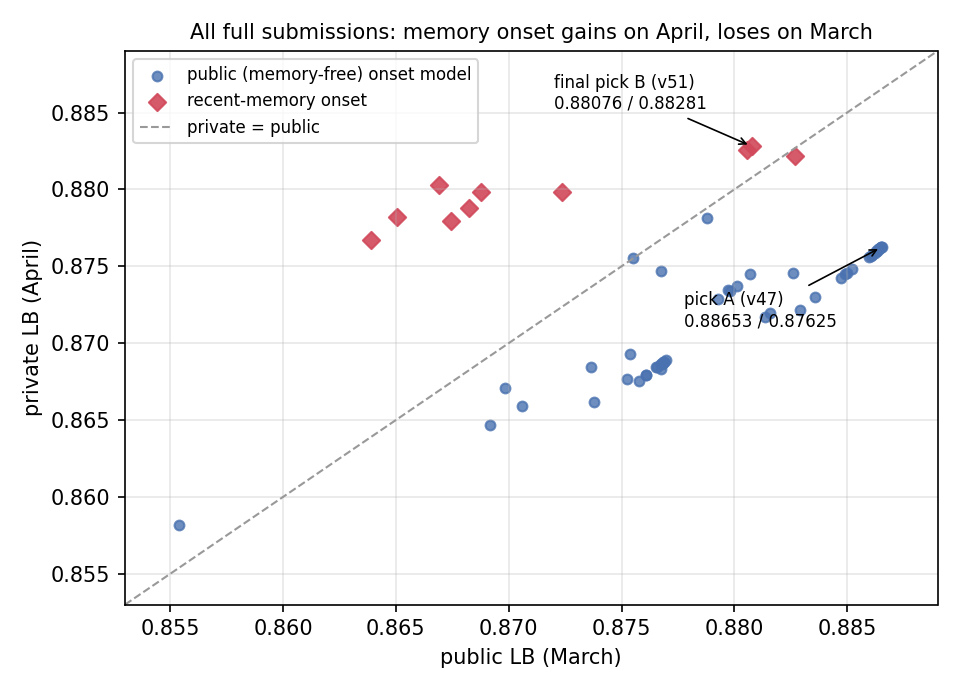
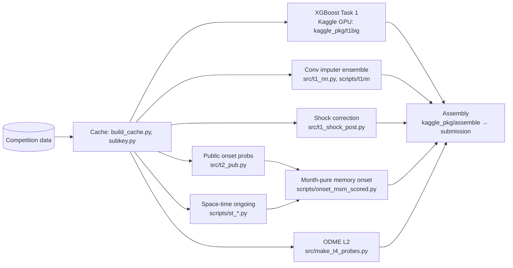

# TrafficFlowBench 2026: causal state reconstruction and queue forecasting under a hidden regime shift

Solution of team **WaelYT** (Zitouni Ouail Imad eddine, ESI Algiers) for the
[2026 IEEE Big Data Cup: TrafficFlowBench](https://www.kaggle.com/competitions/2026-ieee-big-data-traffic-flow-bench).
The competition asks for four things on ten synthetic freeway corridors:

- reconstruct blanked traffic states;
- forecast queues 30 minutes ahead;
- respect traffic physics;
- recover origin–destination demand.

| | Score |
|---|---|
| Private leaderboard (final) | **0.88281**, rank 51 / 802 |
| Public leaderboard | 0.88076 |
| Task 2 post-T deletion test | 80/80 onset + 80/80 ongoing windows identical |

📄 **Technical report:** [`report/TrafficFlowBench_WaelYT_report.pdf`](report/TrafficFlowBench_WaelYT_report.pdf), with its source in [`report/report.md`](report/report.md).

## Highlights

- **A regime shift the public leaderboard could not see.** Across 63 full submissions, recent-memory onset models scored on average **0.0082 higher on private** than on public. Memory-free models scored **0.0079 lower**. The public windows (March 1–5) carried stale February memory; the private windows (April 1–9) kept March's bottlenecks. Our final pick was chosen to be *decorrelated* from the public-best pick, and it became the counting submission at **+0.0066 on private**.
- **Physics is an identity, not a target.** The organizer fluxes make the truth conserve exactly, so S_LWR is a total-variation norm of the Task 1 accumulation errors. We confirmed this with a leaderboard probe: an anchor correction that helps under any other construction lowered the probe from 0.44182 to 0.41821.
- **Strictly causal Task 2.** Every input is stamped at or before the forecast origin T. A deletion test blanks every released cell after T and rebuilds inputs and predictions; they are bit-identical. A negative control shows the test detects leaks.



## Method in one table

| Task | Weight | Approach |
|---|---|---|
| 1 State | 0.35 | XGBoost residual model (74 travel-order features, month-own profiles, corridor free-flow-shock features), plus a 14-network 2-D convolutional imputer ensemble, a shock post-correction, and 10% public outputs |
| 2 Queue, ongoing | 0.15 | Space-time CNN (raw 13-slot × link grid + 104 per-link features → 2-D residual convs → dilated 1-D corridor blocks), 5 seeds, threshold 0.5 |
| 2 Queue, onset | 0.15 | Public LightGBM + CatBoost onset recipe, blended 50/50 at T+30 with a *month-pure memory* of onset footprints on earlier days of the same month |
| 3 Physics | 0.15 | None needed: it is evaluated on the Task 1 answer (§5 of the report) |
| 4 ODME | 0.20 | Non-negative ridge, min ‖Af − c‖² + λ‖f − f₀‖², λ = 0.05 (S_ODME 0.9937) |



## Repository layout

```
src/                 core library: data cache, features, Task 1–4 models, assembly, scorers' helpers, post-T test
scripts/             final-pipeline scripts (space-time ongoing, month-memory onset, post-T checks)
scripts/t1nn/        exact command record of the convolutional imputer ensemble (chain*.sh)
kaggle_pkg/          Kaggle kernels (t1big = XGBoost Task 1 on GPU, assemble = final file); src_ds/ = dataset staging dir
logs/                post-T deletion test logs of the final submission
report/              technical report (PDF + Markdown source), figure, all submissions with public/private scores
REPRODUCE.md         step-by-step reproduction of the final submission (stages A–F)
reproduce.sh         single entry script for the local stages
```

## Getting started

```bash
# 1. environment (Python 3.11; an NVIDIA GPU is needed for the neural stages)
pip install -r requirements.txt

# 2. data: the competition files (not redistributed here)
kaggle competitions download -c 2026-ieee-big-data-traffic-flow-bench -p kaggle_public/
#    unzip into kaggle_public/ (default release root), or set TFB_REL to wherever the release lives

# 3. full reproduction of the final submission (about 9 GPU-hours; Kaggle stages are manual pushes)
bash reproduce.sh            # read REPRODUCE.md first
```

The post-T causality checks can be run on their own:

```bash
python scripts/msm_post_t_check.py                                   # month-memory onset
TFB_RAMPS=1 TFB_FILL_BLANKS=1 python scripts/st2_post_t_check.py     # space-time ongoing inputs
python src/t2_post_t_check.py                                        # feature pipeline
```

## Notes on scope and data

- **Not in this repository.** The competition data, the cached arrays, trained weights and large intermediate predictions are not included. They are rebuilt by the pipeline, and the data is available from the competition page.
- **Third-party models and outputs.** These are public Kaggle work and are credited in the report:
  - the anubisyy onset models (CC0 dataset `anubisyy/trafficflowbench-086517-public-assets`);
  - the yeashusemwal and robinamirbahar Task 1 outputs, used at 7% and 3% of speed.
- **Interpretation of the online rule.** Task 2 uses the organizer `window_history`, the released row at T, and masked-layer cells of *earlier days* only. It never uses the published cells after the blanked buffer (T+19 onward), which the rules forbid.

## Citation

If this work is useful to you, please cite the competition and this repository:

```
Jinxi Wu and Xuesong (Simon) Zhou. 2026 IEEE Big Data-Traffic Flow Bench. Kaggle, 2026.
Zitouni Ouail Imad eddine. TrafficFlowBench 2026: causal state reconstruction and queue forecasting under a hidden regime shift. GitHub, 2026.
```

## License

Code: [MIT](LICENSE). The report and figures are under the same terms. The competition data remains subject to the competition rules.
