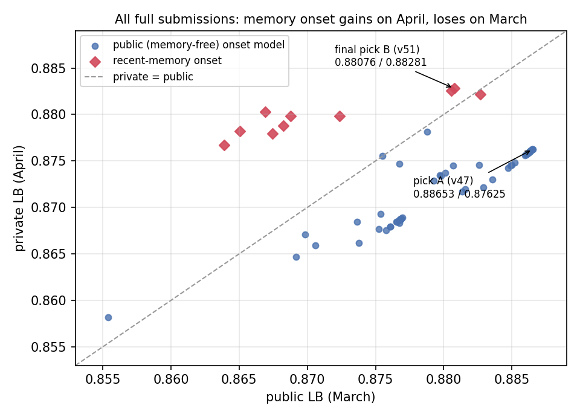

# Causal traffic-state reconstruction and queue forecasting under a hidden regime shift

**{{AUTHOR}}**

2026 IEEE Big Data Cup: TrafficFlowBench. Technical report for the final submission.

**Final result.** The selected submission is Kaggle `tfb-assemble` v51, file `sub_msmU_stF_f0_y7_r3_q80_s80_n85-50_g100_nf5.zip`. It scored **0.88281 on the private leaderboard**, rank 51 of 802, and 0.88076 on public. Everything needed to rebuild it is in the code package: `REPRODUCE.md`, `reproduce.sh`, and the post-T verification logs.

## Abstract

We built one pipeline for all four TrafficFlowBench tasks. It uses only data stamped at or before each forecast origin T for Task 2.

- **Task 1:** a large XGBoost residual model with month-own profiles, a corridor-wide free-flow-shock correction, and a 14-network convolutional imputer ensemble, blended with two public outputs at 10%.
- **Task 2 ongoing:** a space-time convolutional network (5 seeds).
- **Task 2 onset:** the public onset recipe, blended with a "month-pure" memory of earlier days of the same month.
- **Task 3:** physics is never post-processed. We show it is a deterministic function of the Task 1 error.
- **Task 4:** non-negative ridge ODME.

Four findings carry most of the analysis.

1. **The two scored months share a regime that the train months do not.** Across 63 full submissions, the 10 that used recent-memory onset scored on average 0.0082 *higher* on private than on public. All others scored 0.0079 *lower*. Recent onset memory was stale on the public windows (Mar 1–5, memory from February) and fresh on the private ones (Apr 1–9, memory from March). Selecting onset on the public leaderboard therefore pointed the wrong way. Our second final pick hedged exactly this risk and became the counting submission, at +0.0066 private over our public-best pick.
2. **Task 3 conservation is an identity on the truth.** A state-only probe confirmed this on the leaderboard: an anchor-offset correction that would help under any other flux construction lowered the probe from 0.44182 to 0.41821. S_LWR is therefore a total-variation norm of our Task 1 accumulation errors. No physics post-processing can raise it.
3. **Every easy-to-build validation set is biased, in a known direction.** We kept three of them and used each only for the questions it answers correctly (§8).
4. **Task 1 gains are almost noise-free and transfer.** Every Task 1 change moved public and private by the same amount, to within 0.0003.

## 1. Problem and scoring

S = 0.35 S_state + 0.30 S_queue + 0.15 S_physics + 0.20 S_ODME. Every component is in [0, 1].

**Aggregation.** Each component is computed per directional panel. The two directions of a corridor are averaged, then the corridors with equal weight. Task 2 has four corridor families of two panels, so each panel weighs 1/8. Public and private each score 40 onset and 40 ongoing windows. One onset window is worth 0.30 × 0.5 × 1/40 = 0.00375 of the total per 1.0 of IoU. That is our yardstick for whether a leaderboard difference means anything.

**Single-task probes.** A missing task scores 0, so a file with only one task filled measures that task alone:

- An onset-only file scores 0.15 × onset IoU.
- A state-only file scores 0.35 S_state + 0.15 S_physics.

We used about a dozen such probes.

**Task 2 rule.** Only data stamped ≤ T may be used, including the released row at T. Fitting or threshold selection on post-T data is not allowed either. Award entries are rerun with post-T rows deleted.

## 2. Data findings that shaped the design

- **Corridor physics.**
    - One detector per link, links 0.01–1.8 km long, with a triangular fundamental diagram.
    - Jams form at a few fixed heads per panel (4–7: lane drops and merges) and grow upstream.
    - Capacity at the heads is fixed: queue discharge equals the released capacity within 1% in every month.
- **Noise.**
    - Flow noise is about 2.3% (log std) and white.
    - Free-flow speed is a per-link level × (1 + c_t + ε). Here c_t is one corridor-wide shock per (day, slot), and the result is clipped at about 120.7 km/h.
    - Task 2 labels come from the noise-free state.
- **Masks.** Task 1 masks are close to iid per cell at 20/30/50% (R1/R2/R3), with one regime per day.
- **Task 2 windows.**
    - We reproduce the train-split window rule exactly: 60-minute history with coverage ≥ 0.7, 360-minute spacing per condition, earliest origin first.
    - Onset queues appear exactly at T+30 (confirmed by the organizers), so onset is purely a "where" problem.
    - Official ongoing windows are dynamic: their persistence IoU averages about 0.60 and never exceeds 0.9.
- **Per-split regimes.**
    - The onset-place cosine between adjacent train months is 0.93–0.99.
    - From February to March it drops to 0.32 on D12_I5_S and 0.78 on D7_I405_S; from late February to early March, to 0.19. It is a switch, not a drift.
    - D12_I5_S onsets moved from links 54–56 to 84–89, and D7_I405_S from 93–97 to 69–76.
    - Capacity is unchanged, so the shift is driven by demand: per-link peak flow moves 3–11% from February to March, against 0.5–2% between train months.
    - The release says the validation/private scenario seed is "drawn at random and held by the organizers". The private results (§8) show March's onset places persist into April.
- **The post-buffer leak.**
    - The masked layer blanks only T+1 … T+18 around each window, so rows from T+19 onward are published. A queue starting at T+30 is usually still visible at T+95.
    - The rules forbid these rows. We never read a row stamped after T for any Task 2 window. This is verified in §11.
- **Blanks inside the memory of later windows.**
    - On validation and private, T+1 … T+18 of every official window is blank on all links. So the memory features of later windows have holes exactly where earlier queues were.
    - Simulated on February, ongoing IoU drops from 0.9482 to 0.9432. Bridging each link linearly across whole-corridor gaps, using anchors before T only, recovers 0.9465. The bridge is used in the final pipeline.

## 3. Final pipeline at a glance

| Task | Component | Share in the final file |
|---|---|---|
| 1 state | XGBoost residual model (`tfb-t1big`, Kaggle GPU) and convolutional imputer ensemble (14 nets) | ours 90% of speed, 80% of flow; within ours, the imputer takes 85% of speed and 50% of flow, and 100% on all-link gap cells |
| 1 state | public outputs: yeashusemwal U-Net/trees, robinamirbahar physics-guided | 7% + 3% of speed; the remaining 20% of flow in the same 7:3 ratio |
| 1 state | free-flow-shock post-correction | weight 0.8 on free-flow cells |
| 2 onset | public anubisyy LightGBM + CatBoost recipe (CC0 assets) | base probability at T+30 |
| 2 onset | month-pure memory (§6.3) | 50% blend at T+30 |
| 2 ongoing | space-time CNN, 5 seeds | 100%, threshold 0.5 |
| 3 physics | none (evaluated on Task 1) | n/a |
| 4 ODME | non-negative ridge, λ = 0.05 | 100% |

## 4. Task 1: state reconstruction

**Tree model (`t1_train.py`, Kaggle kernel `tfb-t1big`).**

- **Features.** 74 features in travel order:
    - own-link time interpolation;
    - spatial neighbours ±1..±10;
    - free-flow and congestion-wave characteristics;
    - leave-one-day-out weekday × slot profiles;
    - regime and observation context;
    - shock features: the same-timestamp corridor-wide free-flow level read from visible cells.
- **Targets.** Speed residual v/v_f − base, and per-lane flow residual (q − base)/lanes. Corridors are weighted equally.
- **Training.** XGBoost hist on GPU with up to 8,000 targets per corridor-day and 20,000 rounds. It is early-stopped on February and refit on all train days.
- **Holdout score.** S_state 0.9502 on the February holdout.
- **Inference.**
    - The weekday × slot profiles are replaced by month-own profiles, pooled over the scored month's released cells. This is allowed because Task 1 is offline. March pseudo-evaluation: 0.9357 → 0.9405, all ten corridors up; +0.00115 on the leaderboard.
    - Transductive self-training on re-hidden released cells of the scored month (600 rounds).

**Convolutional imputer ensemble (`t1_nn.py`).**

- **Model.** A 2-D convolutional imputer over the (time × link) grid of one corridor-day. Inputs are the released values, the observation mask and engineered base and characteristic channels. It is trained to reconstruct randomly re-hidden cells.
- **Families.** Width 48 (4 nets), width 64 (4 nets), a gap-specialised width-48 model (3 nets), and width 96 (3 nets). Seeds and commands are listed in `REPRODUCE.md`.
- **Holdout.** Width 64 scores S_state 0.9500 on the February holdout and width 96 at least 0.9505. Each family has one holdout-trained member; the others are refit on all days.
- **Combination.**
    - Normal cells: (w48 + 2·w64 + 2·w96)/5.
    - All-link gap cells, where no link is observed at a timestamp: (2·w64 + gap48)/3.
- **Leaderboard steps.**
    - Imputer blend: +0.0020.
    - Version 2 features: +0.0009.
    - Width-96 members: +0.0002.
    - Three more seeds: +0.00003, so the ensemble is saturated.

**Free-flow-shock post-correction.** Free-flow cells are pulled toward level × (1 + ĉ_t). ĉ_t is the corridor-wide shock estimated from the visible cells of the same timestamp. On the March masked layer, S_state goes 0.94054 → 0.94350 at weight 0.8.

**Public-output blending.**

- Our share rose as our model improved: 0.6 → 0.7 → 0.8 → 0.9.
- At 0.9, two public outputs remain at 7% and 3% of speed. Flow keeps a 20% public share.
- Credits: yeashusemwal "Trees + U-Net + CNN", robinamirbahar "Physics-Guided State & ODME". The anubisyy output is loaded but has share 0 in the final file.

**Transfer.** Task 1 leaderboard differences carry over to private almost exactly:

| Task 1 change (same queue) | Δ public | Δ private |
|---|---|---|
| own share 0.8 → 0.9 (nf2) | +0.00006 | +0.00010 |
| 3 more imputer seeds (nf3) | +0.00003 | +0.00005 |
| width-96 members (nf5) | +0.00019 | +0.00023 |
| nf4 + nf5 average (nf6) | −0.00008 | −0.00008 |

## 5. Task 3: physics follows Task 1, proven on the leaderboard

**The identity.** The evaluator derives k = q/v and N = k·L from the submitted Task 1 values. The field is the full eligible truth with our target cells substituted. The organizer boundary fluxes are "projected onto the released observations", so the truth conserves exactly. Hence

E_LWR = Σ|dN_sub − dN_true| / Σ|dN_true| = Σ|e_{t+1} − e_t| / Σ|dN_true|.

Here e is the accumulation error, which is zero except at target cells. S_LWR is therefore a total-variation norm of our errors:

- An isolated target pays about 2|e_t|.
- Inside a run of targets, a smooth (conditional-mean) prediction pays roughly the truth's own step noise per transition.
- So S_LWR has a structural floor near 0.6 for any causal predictor.

**Leaderboard test.**

- **The probe.** We probed the hypothesis directly. A state-only probe of our best Task 1 scored 0.44182. A second state-only probe added an anchor-offset density correction: inside each hidden run, the density is moved by the offsets observed at the two released neighbours.
- **Prediction.** If the hidden truth did not conserve exactly (least-norm or cumulative flux projections), this correction would raise S_LWR by enough to lift the probe to about 0.440. Under the identity, it can only add error, giving about 0.423 ± 0.003.
- **Result.** The probe scored **0.41821**. The identity holds, so there is no physics lever beyond better Task 1 accuracy. A spatial anchor-noise variant built for the same hypothesis was discarded without submission.

**Local numbers.**

- With our blend on the February holdout: S_state 0.9511, S_FD 0.987, S_LWR 0.732, so S_phys 0.817.
- The leaderboard state probe implies S_phys ≈ 0.73 on March, i.e. S_LWR ≈ 0.60.
- March's harder (more congested) cells account for the gap.
- S_FD is already 0.98–0.99 on the truth. FD projections can only trade S_state for S_FD and were rejected (est. −0.0004).

## 6. Task 2: queue forecasting

### 6.1 Inputs, all ≤ T

- The organizer `window_history` (T−60 … T−5) and the released masked-layer row at T.
- Static network data, plus ramp states up to T.
- Masked-layer cells of earlier days of the same split. Whole-corridor blanks are bridged linearly with anchors before T.
- Long-term priors from the train months.

All models are fitted on train months only. Round counts and thresholds are constants.

### 6.2 Ongoing: space-time network

- **Inputs.** A raw grid of 13 slots × links, with speed/v_f, flow/capacity, density/k_crit and ramp channels, plus 104 engineered per-link features.
- **Architecture.** 2-D residual convolutions, then dilated 1-D corridor blocks, with 6 horizon outputs. Trained for 24 epochs, about 12 minutes per seed on an RTX 4060.
- **Ensemble and threshold.** 5 seeds averaged, threshold 0.5. The threshold peaks at 0.5 on the March bench: 0.45 → 0.8713, 0.5 → 0.8828, 0.55 → 0.8758, and step-dependent thresholds are no better.
- **March bench** (windows with persistence ≤ 0.9, official-like): 0.8828 against 0.8587 for our previous LightGBM + CNN ensemble, bootstrap P(gain) = 1.00.
- **Leaderboard:** +0.0028.
- **Seeds.** Ten seeds did not beat five: per-seed IoU is equal, and the gap is thresholding noise on 98 windows.

### 6.3 Onset: public recipe + month-pure memory

**Base model.**

- The public anubisyy LightGBM + CatBoost recipe (83 window-history features, threshold 0.55, top-1 fallback). It reproduces the authors' file exactly.
- Public onset IoU 0.776, the best memory-free model we found.
- On a raw-history February set, its top-1 link is in the true queue in 94% of windows. The misses are at a different bottleneck, 10+ links away.

**Month-pure memory (`onset_msm_scored.py`).**

- For each onset window, we count the onset footprints in the masked layer of the same split's days *before* the window day. A footprint is the set of links queued within 30 minutes after a corridor-wide onset start. Counts are kept in an hour band of ±1 h around T+30.
- The memory m is blended into the public probability at T+30: P = 0.5 P_pub + 0.5 m / max(m).
- It changes 8 public and 10 private windows.

**Why it fails on public and wins on private.**

- **Public: −0.0058.** The public windows fall on Mar 1–5. Their same-month memory is thin, and their 7-day memory comes from February, a different regime.
- **Private: +0.0066.** The private windows fall on Apr 1–9, and April keeps March's onset places.
- **Earlier variants show the same split.** A 7-day recent-memory model (rec7g) and a regime gate both scored 0.010–0.012 better on private than the public recipe with the same Task 1. All seven public-leaderboard comparisons had ranked them below it.

### 6.4 Final picks: hedging an unanswerable question

Kaggle scores the better of two picks. Whether April keeps March's places cannot be decided causally from the release, and the public leaderboard is blind to it (§8). So the two picks were made decorrelated rather than near-identical:

| Pick | Content | Public | Private |
|---|---|---|---|
| A (v47) | best public: public onset + ST ongoing + full Task 1 | 0.88653 | 0.87625 |
| **B (v51, counts)** | same + month-pure memory onset | 0.88076 | **0.88281** |

## 7. Task 4: ODME

**Method.** Per split, non-negative ridge:

min ‖A f − c‖² + λ‖f − f₀‖², with λ = 0.05.

It is solved by L-BFGS-B to convergence. There are 92 mainline segment constraints for 4,278 paths; priors are lognormal (σ ≈ 0.63).

**Leaderboard S_ODME.**

| Variant | S_ODME |
|---|---|
| L2 (λ = 0.05) | 0.9937 |
| entropy/KL to the own prior | 0.8425 |
| KL to a pooled prior | 0.7226 |

At most +0.0013 of the total is left in this task.

## 8. Evaluation methodology and the public/private split

**Three local benches, each trusted only where it is unbiased.**

1. **Raw-history February official-like set** (215 onset / 187 ongoing windows). It matched every leaderboard family ranking for train-regime questions.
2. **Task 1-filled March bench.** It reproduces the leaderboard direction for ongoing models. It also exposes the moved bottlenecks for onset, but its pseudo-windows start on Mar 3, so its memory is fresher than the official Mar 1–5 windows.
3. **Masked pseudo-windows.** These overstate memory (20–50% of history missing); used only for Task 1.

**Rules we followed.**

- March informs April only.
- Nothing is selected on April data.
- Public differences below one window (0.004) are noise for Task 2. Task 1 differences are reliable.

**The public/private split.** Figure 1 plots private against public for every full submission. The correlation is 0.81 overall. The structure is clear:

- Task 1 and ongoing changes move along the diagonal.
- Onset changes split by the memory they use. Recent-memory onset sits 0.016 above the memory-free cloud on the private axis, and even onset changes that only add month-specific information (bottleneck features, the previous-month lift) lost on public but gained on private.

The organizers warn that the two months "were generated independently" with different incidents. Our data says their onset *places* are shared: the demand pattern that decides which heads fire carried over from March to April, while the train months differ.

*Figure 1. Private vs public score of every full submission (public > 0.85). Red: recent-memory onset; blue: memory-free public onset. Pick A is the public best; pick B is the counting submission.*

## 9. Results

| Milestone (cumulative) | Public | Private |
|---|---|---|
| v1: XGBoost Task 1 + persistence/top-3 memory Task 2 + L2 ODME | 0.80565 | 0.80181 |
| LightGBM Task 2 + Task 1 v2 | 0.85538 | 0.85815 |
| 7-day recent-memory onset/ongoing (rec7g) | 0.86390 | 0.87671 |
| + month-own Task 1 profiles, transductive fine-tuning, 30% public state | 0.86691 | 0.88030 |
| public onset recipe replaces memory onset | 0.87610 | 0.86795 |
| Task 1 blend with public outputs | 0.87698 | 0.86888 |
| ongoing with bridged memory + ramps | 0.87971 | 0.87347 |
| Task 1 shock features + big tree model | 0.88013 | 0.87373 |
| space-time ongoing (5 seeds) | 0.88291 | 0.87215 |
| convolutional imputer ensemble (nf2), ours 0.9 | 0.88631 | 0.87597 |
| width-96 imputer members (nf5) = **pick A** | **0.88653** | 0.87625 |
| + month-pure memory onset = **pick B (final)** | 0.88076 | **0.88281** |

**Single-task leaderboard probes.**

- Onset IoU: public recipe 0.776, our first LightGBM 0.690.
- State-only: 0.44182. With the anchor correction: 0.41821.
- S_ODME: 0.9937.

## 10. Negative results (tested, not used)

**Physics.**

- Anchor-offset and spatial anchor-noise density corrections (§5).
- FD projection.
- Public density smoothing: est. −0.0004.

**Task 1.**

- Neighbouring-day input channels: Feb 0.94975 vs 0.95000.
- Length-weighted or L1 flow losses.
- Per-weekday month profiles.
- More imputer seeds (+0.00003).
- 95% own share (−0.00004).

**Ongoing.**

- Expected-IoU decoding (−0.0057 on the leaderboard).
- Thresholds 0.40/0.50 for the earlier model and 0.45/0.55 for the space-time model.
- 10 seeds.
- A 50/50 mix with the public ongoing model.
- A CNN trained on official-like windows only.
- Same-day context (v2 grid).

**Onset.**

- CNN-only (0.627).
- Bottleneck demand-vs-capacity features: public −0.0034, private +0.0010.
- Place-free in-window models.
- Expected-IoU decoding without future eligibility.
- Thresholds 0.50 and > 0.55, link caps, contiguity rules.
- A previous-month "lift" of the public model: public −0.0078 on 5 windows, though private +0.0019.
- The March-augmented public recipe.

## 11. Reproducibility and causality

**Package.** `REPRODUCE.md` and the single entry script `reproduce.sh` rebuild pick B in six stages:

- **A** cache.
- **B** tree Task 1 (Kaggle GPU kernel).
- **C** imputer ensemble and shock correction (about 7 h on an RTX 4060).
- **D** queue: public onset probabilities, space-time ongoing (5 seeds), month-pure memory.
- **E** ODME.
- **F** assembly (Kaggle kernel `tfb-assemble`, job line `msmU_stF 0.9 0.07 0.03 q=0.8 s=0.8 n=0.85,0.5 g=1.0 nf=5`).

**Determinism.** GPU training of the trees, imputers and space-time nets is seed-controlled but not bit-exact. Task 2 queue files and the ODME arrays rebuild exactly from the stored model outputs.

**Post-T deletion tests.** All are run by `reproduce.sh` at the end. For every scored window, every masked-layer and ramp cell stamped after T is blanked (rest of the day, later days, later splits), the inputs or predictions are rebuilt, and compared with the shipped ones:

| Path | Result |
|---|---|
| month-pure memory onset (`scripts/msm_post_t_check.py`) | 80/80 onset windows identical; 80/80 equal to the shipped queue file. Negative control (cutting one day early): 8 windows change |
| space-time ongoing inputs (`scripts/st2_post_t_check.py`) | 80/80 windows bit-identical |
| LightGBM/CNN feature path (`src/t2_post_t_check.py`) | 160/160 windows identical |
| public onset recipe | reads only the organizer `window_history` (≤ T) |

**Third-party material.** All of it is public on Kaggle:

- anubisyy "CatBoost + LGBM + NNLS Pipeline", with the CC0 assets `anubisyy/trafficflowbench-086517-public-assets` (onset models).
- yeashusemwal "Trees + U-Net + CNN" and robinamirbahar "Physics-Guided State & ODME" (Task 1 outputs at 7% and 3%).

## 12. Limitations and lessons

- **The public leaderboard was the wrong guide for onset.** Following it (Oct 25: memory → public recipe, +0.0087 public) cost about 0.012 on private. The final hedge recovered 0.0066 of that. Given the regime evidence of §2, we should have kept a 7-day recent-memory onset in pick A as well.
- **Public onset has only 40 windows** (standard error ≈ 0.025 IoU). No single local bench is unbiased for every question.
- **Physics is capped by Task 1 error** for every causal method.
- **The Task 1 blend depends on fixed public outputs** (10% of speed).
